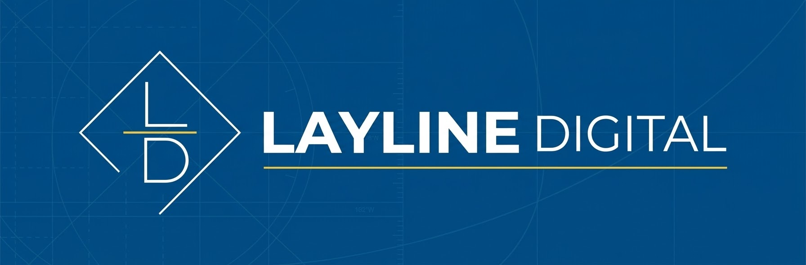



  

  <strong>Pennant Hoist: Sovereign Local-First Command Deck for ATProto, ActivityPub & Nostr</strong>

  
  
  
  
  

---

# Pennant Hoist

A local-first desktop command deck for broadcasting across Bluesky, Mastodon, and Nostr simultaneously.

## Features
- Sovereign key storage on local loopback (127.0.0.1:7420)
- Media airlock with background pre-staging and zero cloud hosting costs
- Embedded SQLite WAL outbox queue with automated retry backoff
- 2D virtualized multi-column operations deck

## Documentation
- [Quickstart Guide](docs/Quickstart.md)
- [Protocol Setup](docs/Protocols.md)
- [Media Airlock & Storage](docs/Airlock-and-Storage.md)
- [Troubleshooting & FAQ](docs/Troubleshooting.md)

## License
Open Core licensed under the MIT License.

