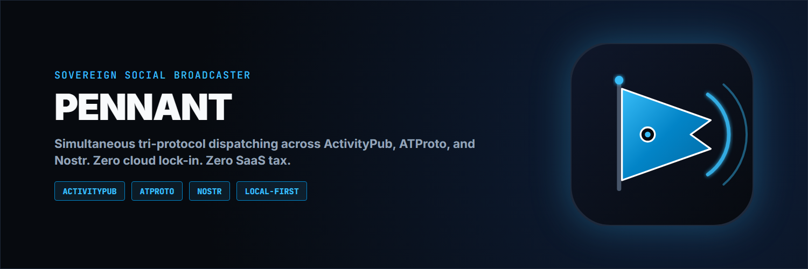



  

  <strong>Pennant Hoist: Sovereign Local-First Command Deck for ATProto, ActivityPub, Nostr & Matrix</strong>

  
  
  
  
  

---

# Pennant Hoist

A local-first quad-protocol desktop and web command deck for broadcasting across ATProto (Bluesky), ActivityPub (Mastodon), Nostr, and Matrix simultaneously.

## Features
- **Quad-Protocol Dispatch:** Concurrent publishing and media staging for ATProto (Bluesky), ActivityPub (Mastodon), Nostr, and Matrix rooms.
- **Loopback Isolation:** Sovereign credential store and HTTP dispatch daemon bound to `127.0.0.1:7420`.
- **Media Airlock:** Client-side SHA-256 hashing and background pre-staging directly to native protocol hosts (PDS, Mastodon, Blossom, Matrix MXC).
- **SQLite WAL Outbox:** Embedded `better-sqlite3` WAL queue and delivery ledger with T-10m pre-staging and automated retry backoff.
- **2D Virtualized Operations Deck:** Multi-column Svelte + Tauri v2 command deck with per-protocol composer constraints.

## Documentation
- **[Quickstart Guide](docs/Quickstart.md)** — Desktop installer targets and running from source (`npm run dev`).
- **[Protocol Setup & Key Configuration](docs/Protocols.md)** — Credentials for Bluesky (App Passwords), Mastodon (OAuth tokens), Nostr (`nsec1` / NIP-46 bunker URIs), and Matrix (homeserver, room ID, access token).
- **[Media Airlock & Storage Engine](docs/Airlock-and-Storage.md)** — Client-side SHA-256 pre-staging, direct PDS/Blossom/MXC dispatch, and SQLite WAL queues.
- **[Troubleshooting & FAQ](docs/Troubleshooting.md)** — Local storage, relay retries, and configuration backups.

## Architecture & Sovereignty
- **Local-First Runtime:** Dispatch daemon binds strictly to `127.0.0.1:7420` (with optional Tauri v2 desktop shell).
- **Local Key Custody:** Private signing keys (`nsec1`), app passwords, and bearer tokens stay in local memory (`SessionVault` / `SignerEnclave` with NIP-01/BIP-340 local signing and buffer zeroization).
- **SQLite WAL Durability:** Scheduled dispatches and ledger records persist in a local SQLite WAL database (`broadcast_queue` and `broadcast_ledger`) without remote cloud dependencies.
- **Adaptive Constraints:** Real-time grapheme, character, and HTML sanitization tracking across ATProto (300 graphemes), Mastodon (500 chars), Nostr, and Matrix.

## License
Open Core licensed under the MIT License.

